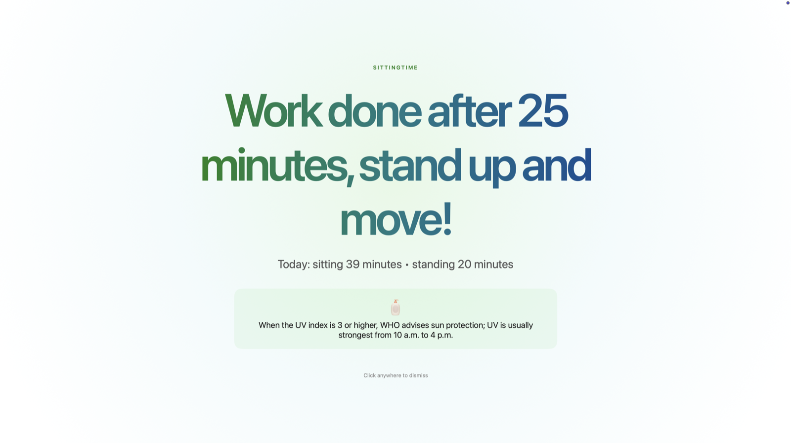
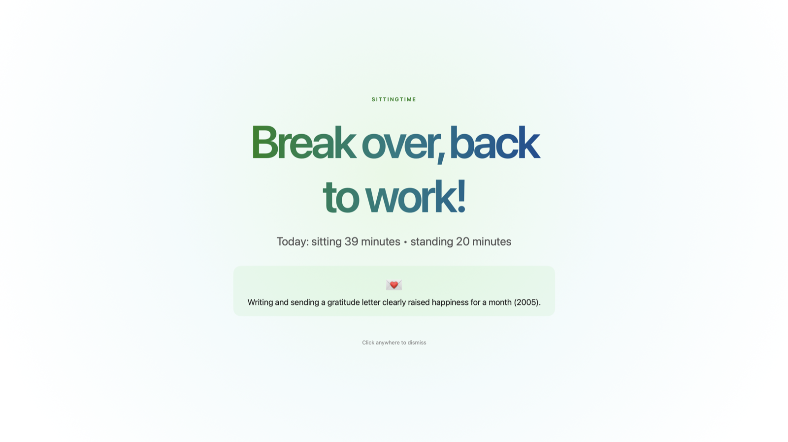
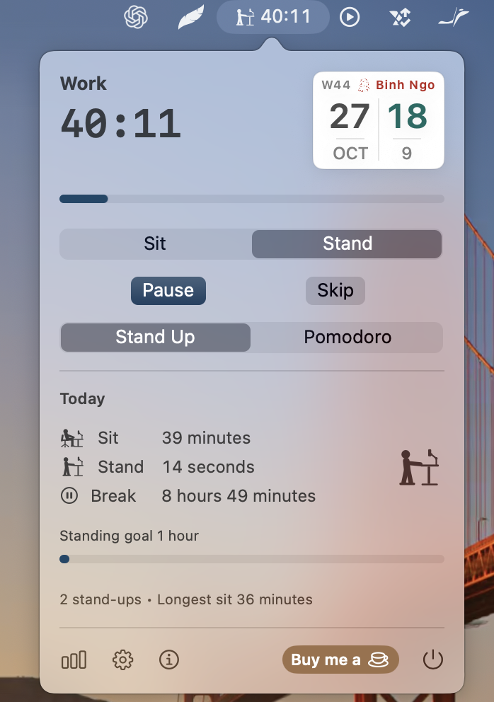
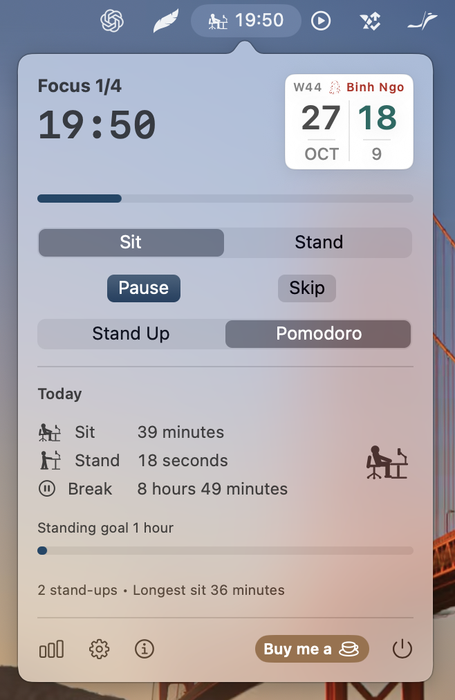
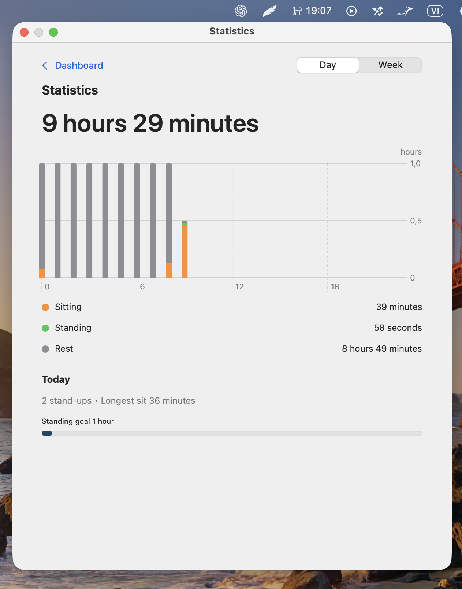
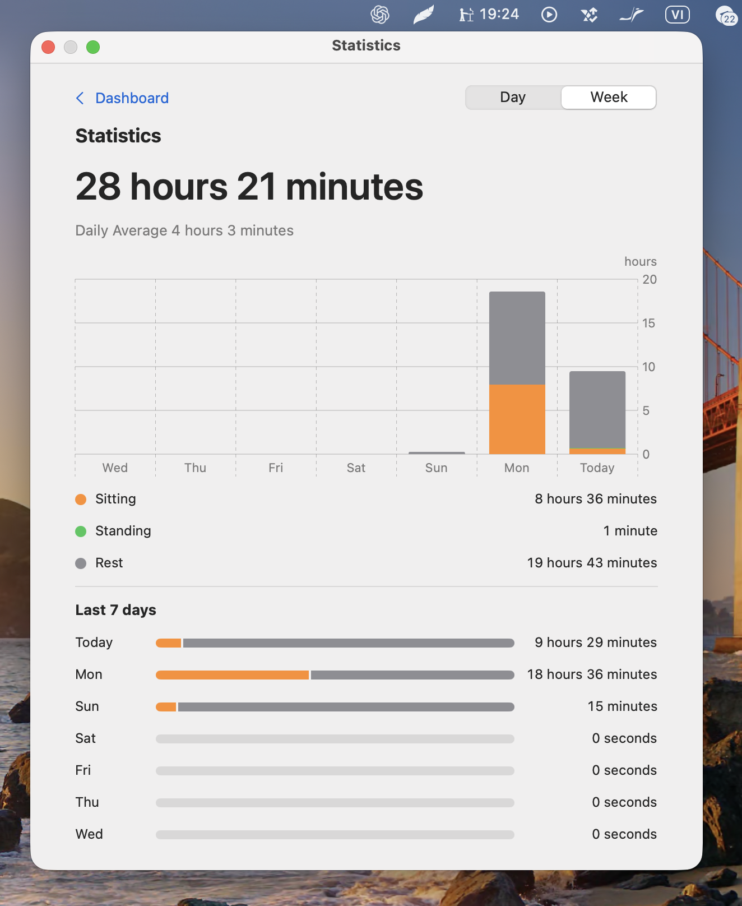
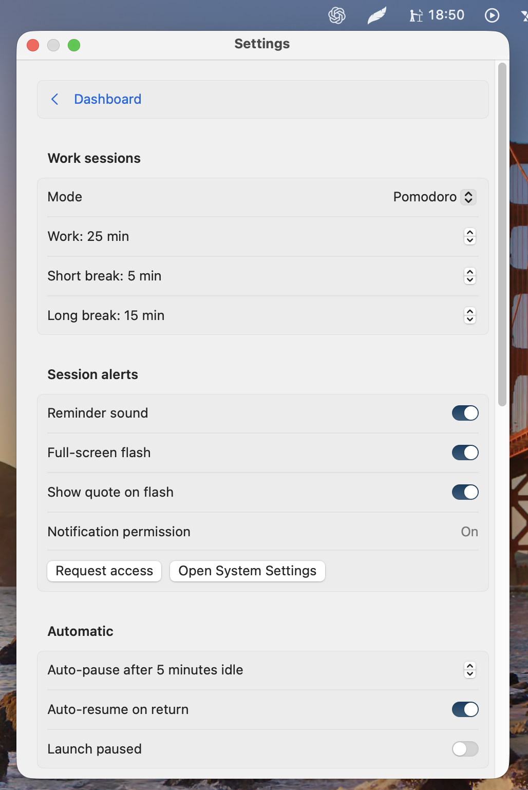
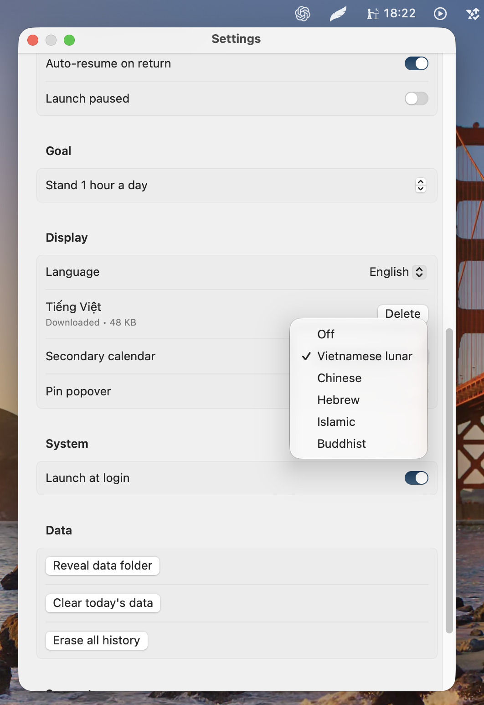

# SittingTime

A lightweight sitting and focus utility that keeps you standing up on rhythm. Two versions:

- **Windows** (Tauri 2, Rust + TypeScript) — this folder.
- **Mac** (native Swift, menu-bar only) — [`macos/`](macos/).

## Windows version

Built with Tauri 2, Rust, and vanilla TypeScript.

The current milestone includes the tray shell and a working Rust timer state machine. The compact UI renders live `MM:SS` state, while Rust owns deadlines, pause/resume behavior, session transitions, and tray actions.

| Work done → stand up | Break over → back to work |
| --- | --- |
|  |  |

## Mac version

A native macOS port (Swift, menu-bar only, no dependencies) lives in [`macos/`](macos/). See [`macos/README.md`](macos/README.md) for full details, build instructions, and testing.

- Flexible work modes: Stand Up (45 work / 5 move) or Pomodoro (25 / 5 / 15) — every minute value editable, plus a daily standing goal.
- Full history log: per-day sit/stand/rest records with 7-day totals and charts.
- A random health quote (of 365) plus chime and full-screen flash on every session change.
- Optional secondary calendar (Vietnamese lunar, Chinese, Hebrew, Islamic, Buddhist) with Can Chi and zodiac on the popover tile.
- Bilingual UI: English built in, Vietnamese as a small download.

| Popover (Stand Up) | Popover (Pomodoro) |
| --- | --- |
|  |  |

| Statistics (Day) | Statistics (Week) |
| --- | --- |
|  |  |

| Settings (sessions) | Settings (display) |
| --- | --- |
|  |  |

## Development

```bash
npm install
npm run tauri dev
```

For a production build:

```bash
npm run tauri build
```

Windows development requires Rust/Cargo, Microsoft C++ Build Tools, WebView2, and Node.js.

The project pins Rust `1.96.0` because some Windows systems with Smart App Control currently block Rust `1.97.1` build executables during Cargo compilation.

On Windows, notification identity is correct for an installed build. During `tauri dev`, Windows may attribute development notifications to PowerShell.

## Project layout

- `src/` — minimal frontend renderer
- `src-tauri/src/timer.rs` — deadline-based timer state machine
- `src-tauri/src/lib.rs` — Tauri commands, worker, and tray behavior
- `src-tauri/tauri.conf.json` — window and bundle configuration
- `SPEC.md` — product and architecture specification
- `AGENTS.md` — implementation rules for future changes
- `macos/` — native macOS port (Swift, menu-bar app)
- `screenshots/` — Windows screenshots used in this README

## Features

- Pomodoro and Stand Up cycles with product defaults; start, pause/resume, skip, reset, mode switching, and live seconds.
- Screen Time-style Statistics (Day/Week, hourly bars, break counts, longest sit) with a configurable daily standing goal.
- Bilingual UI (English/Vietnamese).
- Full-screen reminders with a short bilingual health fact and independently configurable alert sound.
- Native session notifications and optional launch at login.
- Lives in the tray: closing the window keeps the timer running; optional start minimized.
- Settings, timer state, and per-day statistics persist locally.
